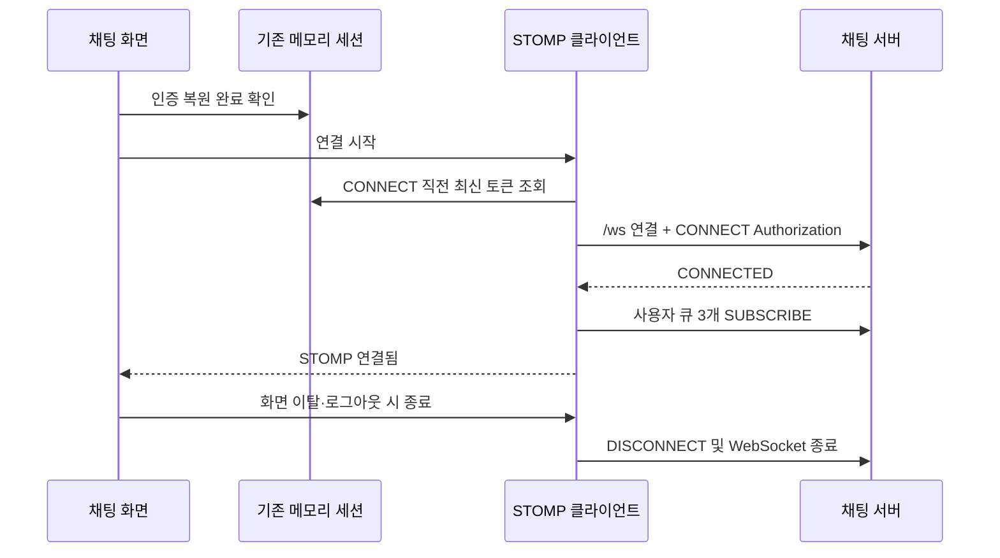

# 채팅 화면의 STOMP 연결·구독 관리 설계

- 작성일: 2026-10-16
- 상태: 2026-10-16 설계 승인 후 구현. 2026-10-18 세션 지원 PR #94와 연결 모듈 PR #95 반영, 화면 연동 PR 준비 중. 실제 브라우저 장애 시나리오 검증은 남아 있다.
- 관련 이슈: [wiki #248](https://github.com/100-hours-a-week/KTB4-16th-wiki/issues/248)
- 목표: 로그인한 사용자가 채팅 화면에서 연결 상태를 확인하고, 연결 장애 후 새 세션으로 재인증·재구독하며, 화면을 떠나면 연결 자원을 정리한다.

### 2026-10-18 최신 UI 통합 조정

문서 제출 범위는 사용자가 정한 `specs` 폴더로 제한한다. 아래 파일별 책임 표의 README·API 연동 문서 변경과 별도 계획 문서는 로컬에 보존하며 이번 PR에 포함하지 않는다.

사용자가 저장소 검토 후 안전한 통합을 요청했다. 연결·인증 정책과 메시지 연동 범위는 유지한다. 프론트 `3af1480`의 헤더·메뉴, ISO 메시지 타입, 이력·스크롤 및 전송 handler 계약을 보존한다. 방 ID는 최신 코드처럼 문자열을 유지하고 BigInt로 양의 signed 64-bit 범위를 검증한다. 기본 메시지 조회 상태는 `not-configured`이며 연결 성공으로 ready로 바꾸지 않는다. 외부에서 `connectionState`를 명시한 페이지는 외부 소유 연결을 사용하고 내부 연결을 추가 생성하지 않는다. 연결 수명의 `idle`과 UI의 기능 미연동 `not-configured`를 별도로 표현한다. 아래 최초 구현 설명에서 달라진 부분은 이 조정을 기준으로 한다.

## 1. 범위와 기준

첫 구현은 연결 주소, STOMP CONNECT 인증, 사용자 큐 구독, Heartbeat, 제한된 재연결, 상태 표시, 종료 처리까지다. 메시지 목록·SEND 버튼·REST 내역 복구의 화면 연동은 다음 작업으로 다룬다. 첫 구현에서 연결 성공을 메시지 복구 완료나 전송 가능으로 표현하지 않는다.

서버는 사용자마다 생성하지 않는다. 실행 중인 채팅 서버에 채팅 화면별 STOMP 클라이언트 하나가 연결한다. 다른 브라우저 탭은 별도 연결을 가질 수 있다. 앱 전체 알림을 위한 상시 연결은 이번 범위가 아니다.

확인 기준은 프론트 `58d1fad`와 후속 `origin/develop` `a33f46c`, 채팅 서버 `origin/develop` `850b169`다. 프론트 후속 두 커밋은 CD 파일만 변경했다. 구현 전 작업 브랜치에 최신 develop을 반영한다.

| 확인한 원본                                         | 현재 내용                                  | 설계 후 내용                                                     |
| --------------------------------------------------- | ------------------------------------------ | ---------------------------------------------------------------- |
| `src/pages/chat-room/ui/ChatRoomPage.tsx:11`        | 연결 상태가 항상 `connecting`              | 실제 STOMP 상태를 Hook에서 받아 표시                             |
| `src/pages/chat-room/ui/ChatRoomPage.tsx:35`        | `connectionState={defaultConnectionState}` | `connectionState={connectionState}`                              |
| `src/entities/session/model/sessionContext.ts:3`    | 토큰 값과 HTTP 요청 함수를 제공            | 최신 토큰 getter와 공유 토큰 갱신 기능도 제공                    |
| `src/shared/api/authenticatedFetchJson.ts:53`       | HTTP 요청끼리만 refresh Promise 공유       | HTTP 요청과 STOMP 인증 복구가 같은 Promise 공유                  |
| `src/shared/api/authenticatedFetchJson.ts:74`       | 모든 refresh 실패에서 세션 제거            | 자격 만료와 일시 장애를 구분해 처리                              |
| `src/features/chat-room/ui/ChatRoomContent.tsx:15`  | 세 가지 연결 상태                          | 최초 연결·재연결·중단을 구분하고 수동 재시도 표시                |
| `src/features/chat-room/ui/ChatRoomContent.tsx:108` | 전송 버튼 비활성                           | 연결 단계에서는 비활성 유지. 메시지 연동 작업에서 전송 조건 적용 |

## 2. 파일별 책임

| 대상                                                          | 책임                                                                                                                  |
| ------------------------------------------------------------- | --------------------------------------------------------------------------------------------------------------------- |
| `package.json`, `package-lock.json`                           | 검증한 버전의 `@stomp/stompjs` 의존성 추가                                                                            |
| `src/features/chat-room/api/chatConnection.ts` (신규)         | STOMP 클라이언트 생성, 연결 콜백, 세 큐 구독, 종료와 재시도 횟수 제어                                                 |
| `src/features/chat-room/model/chatConnection.types.ts` (신규) | 연결 상태·중단 이유·허용 Destination과 수신 콜백 계약                                                                 |
| `src/features/chat-room/model/useChatConnection.ts` (신규)    | React 생명주기와 클라이언트를 연결하고 화면 상태·수동 재시도 제공                                                     |
| `src/entities/session/model/sessionContext.ts`                | `getAccessToken(): string \| null`, `refreshAccessToken(): Promise<void>` 계약 추가                                   |
| `src/entities/session/model/SessionProvider.tsx`              | 최신 토큰 getter와 공유 갱신 함수를 안정적인 참조로 제공. 로그아웃 후 늦게 끝난 refresh가 세션을 되살리지 않도록 제어 |
| `src/shared/api/authenticatedFetchJson.ts`                    | 기존 single-flight refresh를 공개 기능과 공유하고 인증 실패·일시 장애를 구별                                          |
| `src/pages/chat-room/ui/ChatRoomPage.tsx`                     | 유효한 방 ID·인증 준비 상태를 확인하고 연결 Hook과 화면을 조립                                                        |
| `src/features/chat-room/ui/ChatRoomContent.tsx`               | 연결 문구·재시도 횟수·중단 이유·수동 재시도 버튼 표현                                                                 |
| `README.md`, `docs/api-integration.md`                        | 연결 주소, 토큰 재발급의 공유·실패 정책, 연결 단계의 범위 기록                                                        |

채팅 전용 코드는 `features/chat-room`에 둔다. `pages`는 연결 로직을 직접 소유하지 않는다. 기존 의존 방향 `pages → features → entities → shared`를 유지한다. 함수·Hook·서비스에는 역할과 제약을 설명하는 짧은 주석을 작성한다.

## 3. 주소와 연결 시작

- 브라우저의 현재 origin을 기준으로 `/ws` URL을 만든다. HTTP 페이지는 `ws:`, HTTPS 페이지는 `wss:`를 사용한다. 방 ID를 연결 URL에 붙이지 않는다.
- 로컬 Vite의 `/ws` 프록시는 `ws://localhost:8081`로 전달하고 원래 Origin을 유지한다.
- `isSessionRestoring === false`, 로그인 토큰 존재, 유효한 `chatRoomId`를 확인한 뒤 시작한다.
- 토큰의 React 상태가 갱신돼도 클라이언트를 매번 새로 만들지 않는다. 매 CONNECT 직전 getter로 현재 토큰을 읽는다.
- `onConnect`가 호출된 때 STOMP 연결 성공으로 표시한다. WebSocket의 `open`만으로 사용자 인증 성공으로 표시하지 않는다.
- STOMP 프레임·Authorization·토큰 원문을 debug 로그에 출력하지 않는다.

## 4. 인증 복구

기존 유효 토큰으로 CONNECT한다. 재연결마다 refresh를 요청하지 않는다. 서버는 매 CONNECT에서 토큰을 재검증한다.

| 결과                                                                         | 프론트 처리                                                                                                 |
| ---------------------------------------------------------------------------- | ----------------------------------------------------------------------------------------------------------- |
| STOMP ERROR `UNAUTHORIZED`                                                   | 같은 장애 구간에서 refresh 한 번 후 현재 토큰으로 재접속. 다음 CONNECT도 인증 실패하면 자동 시도 중단       |
| refresh HTTP 401                                                             | 메모리 세션 제거. 연결·예약된 재시도 종료 후 기존 보호 라우트 정책 적용                                     |
| refresh 네트워크 오류·HTTP 5xx                                               | 기존 토큰을 즉시 삭제하지 않는다. 이번 인증 복구의 자동 시도는 중단하고 일시 장애 안내와 수동 재시도를 제공 |
| refresh HTTP 403 또는 잘못된 응답 형식                                       | refresh 반복 중단, 안전한 안내와 수동 재시도 제공. 정상 로그인이라고 임의 판정하지 않음                     |
| `AUTH_SERVICE_UNAVAILABLE`                                                   | 인증 서비스 일시 장애로 분류하고 제한된 재연결                                                              |
| `STOMP_DESTINATION_FORBIDDEN`, `COMMAND_NOT_ALLOWED`, 알 수 없는 STOMP ERROR | 자동 재시도 중단. 잘못된 요청을 반복하지 않고 화면에 연결 오류 표시                                         |
| STOMP ERROR 없이 연결이 끊김                                                 | 원인을 인증 실패라고 단정하지 않고 제한된 재연결. 재접속 시 서버의 인증 결과에 따라 처리                    |

토큰 만료 시 현재 서버는 별도 만료 ERROR 없이 WebSocket을 `1008`로 닫을 수 있다. `1008`만 보고 토큰 만료로 확정하지 않는다. 재CONNECT가 `UNAUTHORIZED`를 반환하면 위 인증 복구를 수행한다. JWT 내용을 프론트에서 인증 근거로 사용하지 않는다.

HTTP와 STOMP 갱신은 같은 in-flight Promise를 공유한다. 한 장애 구간의 인증 복구에서는 refresh 요청을 최대 한 번 수행한다. refresh 자체가 일시 장애로 실패했을 때도 자동으로 반복하지 않고 수동 재시도로 새 구간을 시작한다. 로그아웃·다른 로그인으로 세션이 바뀐 후 끝난 이전 refresh 결과는 저장하지 않는다. 갱신을 기다리던 클라이언트가 이미 종료됐다면 CONNECT도 실행하지 않는다.

## 5. Heartbeat·재연결 수치 제안

아래 수치는 문서 검토로 승인된 시작값이다. 공식 문서가 강제하는 값이 아니며, 운영 관측 결과에 따라 조정한다.

| 항목                           | 설계 제안값                 | 이유                                                                                                                |
| ------------------------------ | --------------------------- | ------------------------------------------------------------------------------------------------------------------- |
| 클라이언트 송신·수신 Heartbeat | 각각 10,000ms               | 이미 합의·구현된 서버 제안값과 일치                                                                                 |
| 한 번의 연결 제한 시간         | 10,000ms                    | 응답 없는 연결을 무기한 대기하지 않도록 하는 시작값. 운영 관측 후 조정                                              |
| 첫 자동 재시도 대기            | 2,000ms                     | 짧은 단절 복구를 빠르게 시작하되 즉시 반복 연결하지 않음                                                            |
| 최대 대기 시간                 | 30,000ms                    | 장애 중 재시도 간격에 상한 설정                                                                                     |
| 최대 자동 재시도 횟수          | 최초 연결을 제외한 5회      | 사용자가 끝나지 않는 연결 중 상태에 머물지 않도록 함                                                                |
| 지터                           | 첫 구현에서는 추가하지 않음 | 기존 결정의 범위를 유지하고 라이브러리 기본 지수 백오프를 사용. 다수 클라이언트 동시 장애 시험에서 보완 여부를 판단 |

네트워크 실패만 이어질 때 대기는 `2 → 4 → 8 → 16 → 30초`이며 대기 합계는 최대 60초다. 각 연결이 10초 제한 시간까지 실패하면 최초 시도까지 포함해 약 120초가 걸릴 수 있다. 장애 감지 시간과 브라우저 타이머 지연은 별도다.

StompJS의 지수 백오프·대기 상한·연결 timeout을 사용하고, 자동 횟수 제한만 애플리케이션에서 제어한다. 별도의 재연결 타이머를 중복으로 만들지 않는다. 인증 복구 후의 자동 CONNECT도 같은 5회 예산에 포함하고 예정된 다음 재연결 직전에 refresh한다. 연결 성공 시 자동 횟수를 초기화한다. 수동 재시도는 현재 클라이언트를 정리하고 새 시도 구간을 시작한다. 브라우저 offline 중에는 새 연결·refresh를 시작하지 않고, online 복귀 시 남은 시도 예산으로 재개한다.

Heartbeat는 사용자 메시지가 없어도 연결 상태를 살피는 STOMP 신호다. 정확히 10초에 끊김을 판정한다는 보장은 하지 않는다. 백그라운드 탭에서도 유지되는지 실제 브라우저로 확인하며, Worker 전략 적용 여부는 설치 버전과 테스트 결과에 맞춘다.

## 6. 구독과 종료

매 `onConnect`에서 다음 세 경로를 한 번씩 등록한다.

- `/user/queue/chat-messages`
- `/user/queue/chat-events`
- `/user/queue/chat-errors`

구독은 사용자 단위이며 URL의 방 ID를 구독 경로에 넣지 않는다. 이후 메시지 화면 연동에서는 수신 payload의 `chatRoomId`로 현재 방에 속하는지 확인한다. 서버 Principal과 방 접근 검사를 프론트의 필터로 대체하지 않는다.

첫 구현은 세 구독의 등록·재등록과 수신 경로 분리를 검증한다. 메시지 payload를 화면 메시지로 반영하는 작업은 다음 단계다. 연결 상태가 `connected`여도 현재 전송 버튼은 활성화하지 않으며 화면에 메시지 기능 준비 상태를 유지한다.

현재 서버 인바운드 인터셉터는 `UNSUBSCRIBE`를 허용하지 않는다. 따라서 화면 전체 연결을 정리할 때 구독별 `unsubscribe()`를 보내지 않고 `deactivate()`로 DISCONNECT와 연결 종료를 수행한다. 서버가 연결에 속한 구독을 정리한다. 하나의 연결을 유지한 채 개별 큐만 해제하는 기능이 필요하면 서버 UNSUBSCRIBE 정책을 먼저 확장해야 한다.

화면 이탈·로그아웃·클라이언트 교체 시 예약된 재연결을 중단하고 `deactivate()`한다. 이전 클라이언트의 늦은 콜백이 새 화면 상태나 새 구독을 바꾸지 않도록 세대 구분을 둔다. React StrictMode의 설정→정리→재설정에서도 최종 연결과 구독이 중복으로 남지 않아야 한다.

방 만료와 전체 WebSocket 종료는 별개다. 첫 작업에서 방 만료 이벤트를 새로 발행하지 않는다. 향후 이벤트와 REST 연동에서는 방 상태를 바꾸고 해당 방의 전송을 막는다. 현재 세션 자체가 로그아웃되거나 화면이 끝날 때 전체 연결을 종료한다.

## 7. 화면 상태

연결 상태는 `idle`, `connecting`, `connected`, `reconnecting`, `disconnected`로 표현한다. `disconnected`에는 자동 시도 소진·인증·프로토콜 실패 등 중단 이유를 별도로 둔다.

| 상태           | 화면 표현                                             |
| -------------- | ----------------------------------------------------- |
| `idle`         | 로그인 복원 등 연결 시작 조건 대기                    |
| `connecting`   | 채팅 서버에 연결하는 중                               |
| `connected`    | 연결됨. 메시지 사용 가능 여부는 다음 단계의 별도 조건 |
| `reconnecting` | 다시 연결하는 중, 진행 횟수 표시                      |
| `disconnected` | 중단 이유와 허용되는 경우 다시 연결 버튼 표시         |

오프라인 안내와 인증 재발급 대기를 구별한다. 토큰·내부 서버 오류 상세는 화면에 노출하지 않는다.

## 8. 검증과 완료 기준

1. HTTP/HTTPS 페이지에서 올바른 `/ws` URL을 만든다.
2. 인증 복원 전 CONNECT하지 않으며 매 CONNECT에서 최신 토큰을 사용한다.
3. HTTP 요청과 STOMP 인증 복구가 refresh 한 번을 공유한다. 로그아웃 후 늦은 refresh가 인증을 복구하지 않는다.
4. 실제 CONNECTED 뒤 세 큐를 각각 한 번 구독한다. 재연결 시 새 세션에서 다시 구독한다.
5. 서버와 10초 Heartbeat를 협상하고, 비정상 종료를 감지해 자동 시도한다.
6. 연결 제한 시간·지수 대기·자동 5회·성공 후 초기화·수동 재시도를 제어된 타이머 테스트로 확인한다.
7. 인증 실패·일시 장애·금지 Destination을 구별하고 무한 refresh·무한 CONNECT가 발생하지 않는다.
8. 화면 이탈·로그아웃·StrictMode에서도 이전 연결과 타이머가 남지 않는다. 종료 시 UNSUBSCRIBE를 보내지 않는다.
9. 실제 브라우저에서 채팅 서버의 CONNECTED·세 구독·정상 종료·offline/online·백그라운드 탭을 확인한다.
10. 의미 있는 기능 테스트와 저장소 필수 검사 `prettier`, `lint`, `typecheck`, `build`를 통과한다. 서버 mock 테스트와 실제 서버 검증 결과를 구분해 기록한다.

운영 공개 전에는 인프라 담당자가 실제 `/ws` URL map, WebSocket 전달, TLS, timeout, Origin 허용 목록을 확인해야 한다. 로컬 프록시 성공만으로 운영 연결 성공을 판정하지 않는다. 채팅 서버 여러 대의 구독·메시지 공유는 별도 서버 확장 작업이다.

## 9. 다음 메시지 연동의 경계

REST 입장·방 정보·내역 조회·퇴장, 메시지 SEND, UUID 멱등키, 전송 성공 표시, 수신 데이터 검증, 메시지 정렬·중복 제거·누락 복구는 후속 구현 계획에 둔다. 재연결 뒤 최신 20개만 읽어 모든 누락을 복구했다고 보지 않는다. 마지막 확인 메시지에 닿을 때까지 기존 커서를 쓰는 복구 흐름과 실시간 수신 병합을 따로 설계한다.

서버 A-2·A-3의 SessionConnectedEvent/SessionDisconnectEvent 운영 리스너 추가 여부, 전체 구독 허용·차단 테스트 보완, 방 만료·퇴장 이벤트 발행은 서버 담당 후속 항목이다. 이미 구현된 서버 SUBSCRIBE 허용 목록을 중복 구현하지 않는다.

## 10. 근거

- [React useEffect: 외부 시스템 연결과 정리](https://react.dev/reference/react/useEffect#connecting-to-an-external-system)
- [StompJS: onConnect의 구독, deactivate, Heartbeat, 지수 재연결, timeout](https://stomp-js.github.io/guide/stompjs/using-stompjs-v5.html)
- [StompJS 인증 FAQ: connectHeaders와 beforeConnect](https://stomp-js.github.io/faqs/faqs.html#authentication)
- [Spring STOMP 토큰 인증](https://docs.spring.io/spring-framework/reference/web/websocket/stomp/authentication-token-based.html)
- [Spring STOMP 이벤트: 연결 성립과 종료](https://docs.spring.io/spring-framework/reference/web/websocket/stomp/application-context-events.html)
- [AWS: 지수 백오프·지터·재시도 상한과 단일 계층 재시도](https://docs.aws.amazon.com/wellarchitected/latest/framework/rel_mitigate_interaction_failure_limit_retries.html)
- [Vite server.proxy: WebSocket과 원래 Origin](https://vite.dev/config/server-options.html#server-proxy)
- [프로젝트 STOMP 명세: 검토 기준 커밋](https://github.com/100-hours-a-week/KTB4-16th-CHAT/blob/850b169/specs/MULO_Chat_STOMP_v2.0.md)
- [서버 인바운드 명령 허용 정책](https://github.com/100-hours-a-week/KTB4-16th-CHAT/blob/850b169/src/main/java/com/ktb4/team16/mulo/chat/auth/security/StompConnectAuthenticationInterceptor.java#L45)
- [토큰 만료의 1008 종료](https://github.com/100-hours-a-week/KTB4-16th-CHAT/blob/850b169/src/main/java/com/ktb4/team16/mulo/chat/auth/session/WebSocketSessionRegistry.java#L147)
